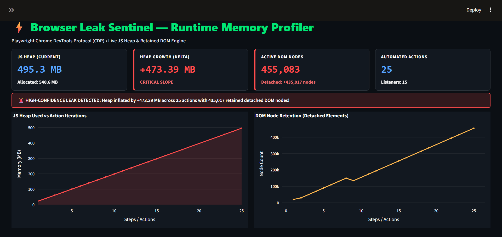
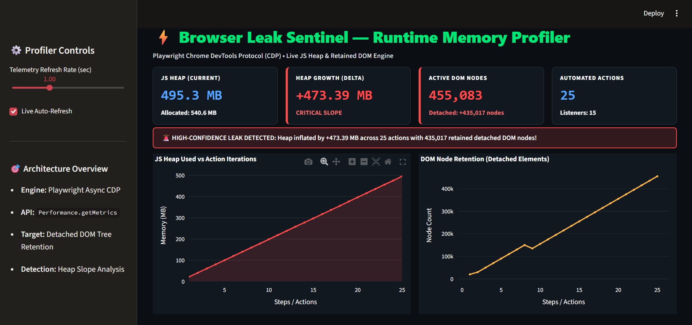
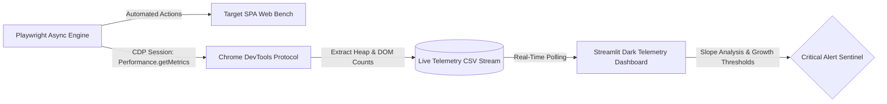

# ⚡ Browser Leak Sentinel — Runtime Memory & Detached DOM Profiler

[](https://www.python.org/downloads/)
[](https://playwright.dev/)
[](https://streamlit.io/)
[](https://opensource.org/licenses/MIT)

An enterprise-grade, deterministic browser memory profiling engine built on **Playwright** and the **Chrome DevTools Protocol (CDP)**. It continuously monitors client-side runtime health, tracks heap slope anomalies, and flags detached DOM node retention leaks during automated user workflows.

---

## 📸 Telemetry Dashboard Previews

### Fullscreen Viewport (Primary Live Telemetry)


### Telemetry Dashboard with Configuration Panel


---

## 🎯 The Engineering Problem

Single Page Applications (SPAs) often suffer from hidden client-side memory degradation caused by:
- Detached DOM elements kept alive by lingering global references or event closures.
- Unbounded array allocations within asynchronous job queues.
- Failure of the JavaScript Garbage Collector (GC) to reclaim disconnected tree structures.

Manual inspection via Chrome DevTools Heap Snapshots is time-consuming and non-deterministic. **Browser Leak Sentinel** automates this entirely: it runs scripted user interactions, taps low-level CDP runtime metrics (`Performance.getMetrics`), streams live telemetry to disk, and triggers dynamic alerts when memory growth slope exceeds safety baselines.

---

## 🏗️ Architecture Pipeline


---

* **​Browser Orchestration:** 
    Playwright asynchronously drives deterministic user action loops on the target benchmark.

* **​CDP Telemetry Hook:**
    Taps Performance.getMetrics at every interaction cycle to capture:

    *  ​JSHeapUsedSize (MB)
    *  ​JSHeapTotalSize (MB)
    *  Nodes (Total active & retained detached DOM nodes)
    *  JSEventListeners (Active event bindings)

* **Live Visual Telemetry:**
    A Streamlit + Plotly dark slate interface displaying metric cards, growth slopes, and detached element retention curves.

---

## ​📁 Repository Structure

```text

browser-leak-sentinel/
├── app/
│   ├── leaky_target.html       # Deterministic single-page memory leak benchmark
│   ├── profiler_engine.py      # Playwright + CDP real-time telemetry collector
│   └── dashboard.py            # High-contrast Streamlit telemetry monitor
├── assets/
│   ├── with_panel.png          # Dashboard screenshot with sidebar controls
│   └── without_panel.png       # Clean fullscreen dashboard preview
├── reports/
│   └── live_telemetry.csv      # Real-time recorded profiling metrics
├── requirements.txt            # Project dependencies
└── README.md                   # Technical documentation

```
---

## 🚀 Quickstart Guide

1. **Clone the Repository:**
```
git clone https://github.com/satyanarayana51115/browser-leak-sentinel.git
cd browser-leak-sentinel
```
2. **Set Up Environment:**
```
python -m venv .venv
```
3. **Activate On Windows:**
```
.\.venv\Scripts\activate
```
4. **Activate OnLinux/macOS:**
```
source .venv/bin/activate
```
5. **Install Dependencies:**
```
pip install -r requirements.txt
playwright install chromium
```
6. Launch the Real-Time Telemetry Dashboard:**
Open your primary terminal and execute:
```
streamlit run app/dashboard.py
```
7. **Start the Automated Profiler Engine:**
In a second terminal window, initiate the 
headless/headed profilint run:
```
python app/profiler_engine.py
```
---

Watch the live memory and DOM retention curves populate dynamically on the dashboard.

## ​📊 Recorded Telemetry Benchmark

```text

Iteration Step JS Heap Used (MB) Retained DOM Nodes Delta Status
Step 01 ~21.9 MB 30,066 Baseline Baseline
Step 10 ~199.0 MB 1,55,053 Sustained Slope Increase
Step 25 ~495.3 MB 4,55,083

```
---

## 🛠️ Tech Stack

* **Language:** Python 3.10+

* **Automation Engine:** Playwright Async API

* **Protocol:** Chrome DevTools Protocol (CDP - Performance domain)

* **Visualization:** Streamlit, Plotly Graph Objects

* **Data Pipeline:** Pandas, CSV stream

---

## 👤 Author

​Manepalli Satyanarayana (Satya)

* **GitHub:** @satyanarayana51115

* **​Portfolio:** satya-automation-portfolio


